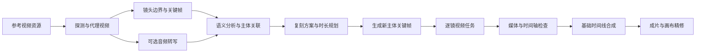

# 一键复刻：参考视频复刻模块设计

状态：实现中（2026-10-31）。已接入独立一级菜单与功能开关、复刻项目及持久运行 API、媒体拆镜、模型任务调度、资源引用保护和列表/新建/工作台页面；真实模型、媒体样本与浏览器链路尚未完成端到端验收，不能据此宣称完整闭环已交付。用户已确认方向为“参考视频复刻”，首版优先通用短视频，保留镜头与节奏并替换主体。本文仍作为设计目标；实际实现和待验收边界见 [待测试记录](../content/docs/progress/pending-test.mdx)。

## 1. 产品定义与首版目标

用户提供一条参考视频和新的主体素材，系统拆解参考片的镜头、内容和时间轴，生成新的分镜与视频，再按目标节奏合成。产物包括可下载成片、可编辑镜头方案、每镜素材和执行记录。

核心价值是复用参考片的拍摄与剪辑结构，减少从零写提示词、逐镜生成和手动拼接的工作。镜头顺序、时间轴、画幅是可校验的约束；构图、动作、运镜、人物与风格还原是生成目标，不能承诺逐像素或逐帧一致。

示例：上传一条 30 秒、8 个镜头的饮品短片，提供新饮品的产品图，选择保留景别、运镜和节奏。系统识别原商品出现的镜头，先生成新商品的对应关键帧，再生成镜头视频并拼成约 30 秒的新短片。8 个镜头可能需要购买超过 30 秒的模型生成量，界面分别展示“成片时长”和“计费生成时长”。

首版建议目标范围：单条参考视频、最长 60 秒、最多 20 个源镜头、一次替换一个主要人物或产品、每镜默认一个候选。这些是待样本验证的产品边界，实施时由服务端配置并在上传前展示，不能用截断文件或丢镜头来满足限额。长片可先选择片段，更多主体与批量变体后续扩展。

## 2. 功能与交互

| 模块 | 首版功能 | 交互与输出 |
| --- | --- | --- |
| 复刻项目库 | 新建、搜索、继续制作、查看进度和成片 | 封面、原片时长、阶段、完成镜头数、费用；打开列表不自动创建项目 |
| 参考片导入 | 本地上传、选择已有视频素材、截取复刻区间 | 统一存成资源；显示格式、画幅、时长、音轨和上传状态 |
| 视频拆解 | 镜头切分、代表帧、景别、动作、运镜、主体、对白与声音描述 | 原片播放器与镜头列表联动；可拆分、合并和校正边界 |
| 复刻设置 | 保留镜头顺序、节奏、景别/构图、动作/运镜；替换主体与整体风格 | 分别控制，不用一个“相似度百分比”承诺所有效果 |
| 主体绑定 | 原人物/产品对应新素材，指定出现的镜头 | 支持文字纠正识别、选库素材、上传参考图、锁定素材版本 |
| 分镜制作 | 原关键帧与新关键帧对照、编辑描述、单镜生成、重试、版本选择 | 每镜保留原片区间、目标时长、实际生成时长、状态与错误 |
| 运行与费用 | 阶段进度、已完成镜头、暂停、恢复、取消、仅重做失败项 | 区分估算、已预占、已结算和剩余额度；离开页面仍运行 |
| 成片交付 | 原片/结果对照、MP4 下载、可选 SRT、到画布精修 | 成片绑定镜头版本清单，缺镜头时不能标记完整成片 |

### 2.1 独立菜单与模块入口

主侧栏新增一级菜单 **一键复刻**，标识为 `remakes`，与“创作影棚”“自由画布”“短剧 Agent”平级，建议排在“短剧 Agent”之后。用户直接从这个菜单完成整个流程；素材视频菜单及画布视频节点中的“以此复刻”是附加快捷入口。

| 页面 | 路由 | 责任 |
| --- | --- | --- |
| 我的复刻 | `/remakes` | 默认菜单落点；查看项目、筛选状态、继续制作、新建复刻 |
| 新建复刻 | `/remakes/new` | 上传或选择参考视频，设置主体与基础参数；明确创建后才保存项目 |
| 复刻工作台 | `/remakes/:id` | 在同一项目内完成分析、方案、分镜、运行与成片，展示本项目任务和费用 |

列表页顶部提供“新建复刻”和搜索，正文展示草稿、制作中、待处理、已完成项目。工作台提供“返回我的复刻”，四阶段导航属于本模块内部。深链接和刷新均可从服务端恢复项目，当前阶段通过项目状态及页面选择确定，不依赖先进入画布。

复用现有全局工作区外壳、登录、主题和账户入口；模块拥有自己的页面布局、空态、上传入口、项目设置、任务进度和成片页。一级菜单在项目详情路由下持续高亮。用户无需创建短剧、画布或画布节点，就能完成上传到成片的全部流程。

实现沿用 `WorkspaceLayout`、`RequireAuth` 和路由延迟加载；将页面加载器接入 `workspace-route-modules.ts` 以支持侧栏预加载。当前选中逻辑按路径第一段识别模块，可直接匹配 `/remakes/*`；侧栏折叠时显式使用简称“复刻”。功能开放采用独立复刻开关（建议字段 `videoRemakeEnabled`），同步菜单、路由、后台设置与服务端写路径，不能借用短剧或影棚开关。

### 2.2 工作台与执行模式

工作台采用“参考片 → 复刻方案 → 分镜制作 → 成片”四阶段。顶部显示项目名、保存/运行状态与费用；中央显示原片和当前结果；下方显示镜头条；右侧按选择对象展示主体绑定或镜头设置。窄屏切换原片/结果标签，避免两个不可辨认的小播放器。原片与成片按镜头映射同步定位，不能只同步播放器的绝对秒数。

关键帧对照优先于大段提示词。用户首先决定“保留什么、替换什么”，模型及参数放高级设置；当前采用版本、原素材与生成素材均有明确标记。支持保存中、服务端已保存、仅本地草稿、上传失败、分析待校正、预算不足、部分失败和结果过期等状态。

两种模式共用同一份计划和执行器：

- **快速复刻**：完成素材绑定、模型预设与预算配置后，点击一次持续执行到成片。分析后报价仍在授权上限内即可继续；关键输入缺失或预算不足时进入待处理状态。
- **精修复刻**：先拆镜与生成关键帧，用户检查后再批量生成视频。默认推荐首次使用者选择，降低主体错误扩散到整片的成本。

## 3. 首版范围与后续能力

| 优先级 | 范围 |
| --- | --- |
| 首版闭环 | 上传/选素材、物理时间轴与语义拆镜、单主体替换、关键帧对照、单镜/批量生成、固定节奏基础合成、失败恢复、费用与版本 |
| 下一阶段 | 多主体映射、配音替换、烧录字幕、节拍识别、可靠的跨镜连续性、常用转场、多个候选版本 |
| 扩展阶段 | 产品/文案批量变体、模板库、长视频分段、平台链接接入、特定模型的视频编辑或运动参考模式 |

首版不把社交平台页面抓取、精确口型同步、复杂运动迁移、复杂多画面合成作为前置条件。参考视频链接导入后续通过现有资源导入边界接入；平台页面地址不等于可下载视频地址。

音频首版显式提供“沿用原片音轨、使用生成音轨、静音”。沿用原片仅在时间映射可保持同步时自动采用；生成音轨与原音轨不默认叠加。字幕属于独立开关：有可靠转写才生成 SRT，转写未配置时允许无字幕路径，并说明能力状态。首版不自动重写对白；换台词与替换配音后续作为单独能力，需解决时长与口型问题。

## 4. 当前代码基础与真实缺口

以下结论来自代码阅读，尚未执行真实模型、浏览器或服务端联调。

| 当前基础 | 代码入口 | 复用边界 |
| --- | --- | --- |
| 视频输入交给文本多模态模型，返回分镜与源时间戳 | `web/src/pages/canvas/list-mode-generator.ts:33`、`:372`、`:383` | 可复用字段和模型调用合同；时间戳目前来自模型，新增严格验证与物理切镜依据 |
| 表格转分镜脚本并抽关键帧 | `web/src/pages/canvas/project.tsx:2104`、`:2143` | 可复用画布投送结构；页面内的流程不承担新模块后台调度 |
| 浏览器按时间抽帧、部分失败反馈 | `web/src/lib/canvas/canvas-video-frame.ts:28`；`web/src/pages/canvas/use-canvas-media-tools.ts:290` | 用于手动取帧和校正预览；批量分析需服务端执行，不能依赖页面存活 |
| 分镜已有源时间范围与关键帧时间 | `web/src/types/canvas.ts:108`；`web/src/lib/canvas/canvas-batch-storyboard.ts:98` | 映射到复刻合同，不把画布节点 ID 当业务主键 |
| 模型能力匹配、图片/视频参考与后端任务提交 | `web/src/pages/canvas/list-mode-generator.ts:337`；`web/src/services/api/generation-task.ts` | 使用已有模型目录、渠道与任务能力，不增加直连模型供应商的前端通道 |
| 短剧具备设定、镜头、生成段、版本和作业 | `backend/internal/model/models_drama.go:131`、`:162`、`:190`、`:204` | 借鉴其产品行为，复用底层服务；参考片不硬塞进小说/剧本合同，DramaJob 不是现成通用工作流 |
| 服务端字幕转写任务 | `backend/internal/app/task_timeline.go:203`；`backend/internal/app/transcription_whisper.go:60` | 依赖配置的 whisper.cpp 服务与 ffmpeg，不能仅凭 API 存在就认定环境可用 |
| 服务端时间线渲染与资源保存 | `backend/internal/app/task_timeline.go:264`；`backend/internal/app/task_render.go:26` | 可复用任务、资源授权、基础成片产出 |
| 时间线实际合成能力 | `backend/internal/app/timeline_render_plan.go:205`、`:277`、`:314` | 已支持顺序拼接、裁切起点、缩放补边、多音轨混音及黑白淡入淡出；字幕仅伴随 SRT，无通用跨镜转场或视觉多轨叠加 |
| 任务具有租约、尝试和供应商取消状态 | `backend/internal/model/models_task.go:9` | 复用单次任务执行；新增复刻依赖编排、修订绑定与汇总状态，不假定已有完整持久工作流 |

实际需要新增的核心是：视频分析产物、保留/替换规则、镜头到生成片段的映射、按修订运行的编排器，以及单镜对照和局部重做工作台。

## 5. 技术路线选择

| 路线 | 优势 | 约束 | 建议 |
| --- | --- | --- | --- |
| 整条视频交给视频编辑模型 | 接入少、某些模型可保留原动作 | 严重依赖模型是否支持视频编辑、片长与替换精度，难逐镜修改和控费 | 作为后续能力适配器 |
| 拆镜 → 新主体关键帧 → 逐镜视频 → 合成 | 可检查、可重做、能复用现有任务和剪辑基础 | 需处理跨镜一致性、短镜头计费和时长映射 | 首版主路线 |
| Agent 自由规划并调用工具 | 适合开放创意与复杂调整 | 执行轨迹、费用和恢复难确定 | 用于解释与编辑方案，调用同一受约束 API |

首版采用确定性流程驱动模型。AI 负责视觉理解和创意描述，代码负责校验、权限、状态迁移、任务派发、预算、版本选择和成片写入。

## 6. 处理流水线



### 6.1 预处理与分析

服务端以 ffprobe 获取真实时长、画幅、帧率、旋转、编码和音轨；必要时生成分析/播放代理。源文件保持不变。ffmpeg/ffprobe 使用参数数组与受控临时目录，输入只能来自已校验归属的资源。

首版切镜候选可用 ffmpeg 的场景变化检测，再结合最短镜头间隔、黑场与相邻帧变化进行整理。快速运动、闪光与渐变容易误判，不能把阈值检测当作完整视觉理解。多模态模型基于候选片段、带时间戳的代表帧和可选转写补充语义，并可提出合并/分拆建议。

对支持原生视频输入的模型可发送受限视频片段；仅支持图像输入的模型使用按时间排序的多帧序列，但要标注动作、运镜判断能力下降。超出参考数量或上下文限制时按片段分批并汇总，不假设任何模型都能直接理解整条视频。

分析产物包含源区间、证据帧、镜头描述、主体 ID、对白来源、可见文字、声音信息与待确认项。对白优先来自 ASR，画面文字与口播分开存；模型不能凭画面猜测对白并冒充转写。AI 返回的“置信度”只能当作提示，需与媒体边界、ASR、跨帧一致性等证据一起判断。

物理时间轴负责校验：`0 <= sourceInMs < sourceOutMs <= sourceDurationMs`，所有源镜头按顺序覆盖选定区间。无解释的重叠、缺段、空镜头和越界都不能进入生成。无切镜的长镜头可作为一个源镜头，之后按模型片长拆成多个生成单元。

原片文字、字幕和转写都视为素材内容，不能被解释为操作指令。完整视频、关键帧、转写和失败日志均按用户隔离。

### 6.2 保留项与主体替换

每条复刻方案独立记录 `preserve` 与 `replace`：

- `preserve`：镜头顺序、目标时长、景别/构图、动作意图、运镜意图、可选音频。
- `replace`：源主体 ID → 目标素材及版本、风格描述、适用镜头列表。

保持时间轴为默认硬约束，构图与运动为生成目标。目标主体素材固定版本，并在全部引用镜头共享外观描述、参考图与角色/产品标识。多角度参考图作为同一主体的参考包，不能被识别成多个主体。

替换主体时，先按原镜头构图生成新主体关键帧，再用于图生视频。原帧是构图证据，目标素材是身份依据；两种用途在提示词和支持的引用角色中明确区分。若通道不支持引用角色，编译器通过输入组织和模板明确用途，不伪造不存在的 API 参数。

不能直接把原人物/原商品关键帧作为已经替换完成的首帧。快速模式对主体缺失、未绑定、明显残留原主体等阻断项进入 `needs_attention`；风格偏差等质量提示可以记录后继续。精修模式统一检查新关键帧。视觉检测只辅助筛查，用户可随时改选或重做。

### 6.3 三层时间模型

| 对象 | 关键字段 | 用途 |
| --- | --- | --- |
| 源镜头 SourceShot | `sourceShotId, sourceInMs, sourceOutMs, evidenceFrameIds` | 追溯参考片中的真实区间 |
| 生成单元 GenerationUnit | `unitId, sourceShotIds, requestedDurationMs, modelSpec, dependencyIds` | 满足模型支持的秒数与参考条件，决定真实生成成本 |
| 成片片段 EditClip | `unitId, takeId, trimInMs, trimOutMs, timelineStartMs, targetDurationMs` | 从生成候选选取内容，确定最终节奏 |

首版默认每个源镜头对应一个或多个生成单元，明确保留映射；不默认合并多个源镜头让模型自行控制切点。2 秒源镜头可能请求 5 秒生成，再选出 2 秒。生成提示词应把关键动作安排在预定使用区间；质检发现裁切会丢动作时需重选区间或重做，不能只盲裁前 2 秒。

模型单次时长不足时拆成多个单元，在同一连续性组内传递末帧或动作状态；硬切换的不同镜头无需串成全局首尾帧依赖。首版默认不通过任意变速凑时长，尤其不能把对白自动加速。按输出帧率量化剪辑点并分配舍入误差，避免多镜头累计导致成片时长漂移。

报价按请求的生成秒数、分辨率、参考输入与候选数计算，不按成片秒数直接乘单价。

### 6.4 合成与检查

复用现有 TimelineProject 合同和服务端渲染路径，新增 `remake -> timeline` 编译器。编译器只使用当前采用的候选和显式裁切区间；提交前检查每镜素材存在、归属正确、资源可读、规格/实际时长满足要求、时间线无意外空隙或重叠。

当前通用导出存在跳过失去媒体来源片段的行为，新模块完整成片路径必须强校验，禁止静默丢镜头。允许用户明确删除某镜头并发布新修订后重新合成。

首版只编译已验证支持的基础视频串接与音频模式，导出 MP4 和可选 SRT。烧录字幕、跨镜转场、画中画、变速等不能仅从前端预览推断服务端支持，应逐项补能力合同与导出测试。

技术完成检查包括：全镜头覆盖、所有采用资源可解码、视频实际时长、最终画幅、音轨模式和资源保存结果。人物一致性、产品细节与运动效果单独展示检查提示，不用无依据的“复刻相似度 98%”代替证据。

## 7. 代码职责

独立模块包含导航、页面、业务 API、领域逻辑和业务记录，运行在现有前后端应用内。账户、模型渠道、资源存储、底层 Task、计费和渲染仍是公共基础能力。复刻业务 ID 与短剧项目/画布 ID 分开；任务来源通过明确的复刻项目、运行和步骤关联表达，实施时检查现有 Task 创建合同，不能为通过旧接口校验伪造画布项目。

```text
web/src/constant/navigation-tools.ts   注册 remakes 菜单元数据
web/src/components/layout/workspace-sidebar-nav.tsx
                                      在创作主导航中增加一级入口
web/src/router.tsx                    独立列表、新建、工作台路由
web/src/pages/remakes/                 index、新建、四阶段工作台、私有组件与 hook
web/src/services/api/remakes.ts        复刻 API 与响应类型，统一使用 http
web/src/lib/remake/                    时间映射、展示状态、纯转换与验证
web/src/services/remake-canvas.ts      原片/分镜/产物投送及明确采用

backend/internal/handler/remake.go     请求、身份上下文、响应
backend/internal/service/aliases_remake.go
                                      仅再导出 app，保持既有导入面
backend/internal/app/remake*.go        组合根，注入任务/资源/模型/计费适配器
backend/internal/remake/               分析合同、计划编译、替换策略、依赖与状态机
backend/internal/repository/remake*.go 持久化、版本 CAS、步骤领取与唯一约束
backend/internal/model/models_remake.go
                                      复刻业务记录
```

域包通过接口使用任务提交、资源读取与预算服务，不 import `app` 或 `service`。通用媒体探测/抽帧逻辑若与现有任务重复，在实施阶段抽取最小共享能力；不复制整个短剧调度器，也不先建设一个全项目通用 DAG 平台。

模型协议继续走现有 provider/渠道/任务基础；复刻步骤只能编译合法请求，不能绕过模型能力、用户分组和存储额度。关键状态保存在后端；React Query 读取服务端进度，本地只保存带用户 scope 的草稿与 UI 状态。

画布是精修入口，复刻项目仍是业务事实源。M3 首版只做单向投送原片、镜头与选用视频，完整成片闭环在复刻工作台内完成。M4 再实现画布结果显式“采用到复刻”，携带源修订和镜头 ID，生成新候选/修订。避免画布编辑自动双向覆盖运行中的复刻数据。

## 8. 持久化与版本设计

建议先复用现有 `Task`、资源、素材与结算记录，增加以下复刻记录，不重复存视频二进制：

| 记录 | 内容与用途 |
| --- | --- |
| RemakeProject | 所有者、标题、源资源、当前分析、当前草稿与 `draftVersion` |
| RemakeAnalysis | 源文件摘要、分析/提示词版本、镜头/主体/转写快照及证据；完成后不可变 |
| RemakeRevision | 已校验的不可变复刻方案、分析 ID、替换素材版本、镜头与时间映射 |
| RemakeRun | 不可变请求快照、发起时草稿版本、执行修订 ID、选用清单及版本、模式、预算、状态与费用 |
| RemakeStep | 逻辑步骤、依赖、输入摘要、状态、关联任务及持久化尝试记录 |
| RemakeTake | 某镜头/单元的图片或视频候选、资源、模型、参数摘要、实际时长与来源修订 |
| RemakeExport | 成片资源、运行/修订、选用候选清单、时间线快照与可选 SRT |

首版镜头数量有明确上限，可以在分析和不可变修订中保存有 schema 的结构化快照；不同时维护一份可随意修改的镜头表和一份互相冲突的 JSON 真相源。草稿采用 `expectedVersion` 乐观锁。

快速模式可在拆镜前启动：先冻结源资源/区间、目标主体参考包、保留项、模型预设、预算及发起时草稿版本，形成 Run 的不可变请求快照。此时执行修订 ID 可为空；服务端完成分析、绑定与计划校验后，用条件更新一次性绑定不可变 RemakeRevision，再检查报价并派发生成。生成步骤必须绑定执行修订，不能读取当前可变草稿。精修模式若已经有完整方案，可在启动时直接冻结修订。分析到后续生成的衔接始终由服务端推进，不依赖前端再发送下一条请求。

分析完成时若用户已修改草稿，只把旧输入的分析/方案保存到原 Run，不覆盖新草稿；运行展示其绑定版本。精修审核后若修改了生成输入，则发布新修订并创建后续 Run，复用输入摘要一致的成功产物；不能在一个已派发的执行修订里原地改参数。

生成要求与结果选用分开记录：RemakeRevision 保存镜头要求，Run 的 `selectionManifest + selectionVersion` 保存当前选中的关键帧、镜头候选。只有对应下游步骤尚未派发时才能通过 CAS 修改该条选用记录。精修模式在关键帧就绪后进入 `awaiting_review`；`approve_and_continue` 原子校验选用清单版本、候选归属、规格与剩余预算，并把选用结果冻结到下游步骤输入。快速模式按同一规则自动采用合格候选。下游已派发后再换关键帧或候选，建立新的后续 Run，不改在途步骤；只改变选用而未改变生成要求时可复用原 Revision。

步骤的每次新上游尝试都可追溯，不能只覆盖一个 taskId 而丢失历史。资源引用参与既有删除保护；删除项目先处理运行与业务引用，不能顺手物理删除被画布或其他项目使用的素材。源文件摘要用于本用户范围内识别重复分析，不暴露跨用户的缓存命中。

变更与失效规则：

| 改动 | 需要重新计算的范围 |
| --- | --- |
| 改项目标题 | 无生成任务 |
| 改字幕文本、音量或选用音轨 | 相关字幕/音频及成片；采用首版已有能力范围 |
| 改单镜视频提示词 | 该镜视频及成片；关键帧可继续用时不重新生图 |
| 改单镜构图/新主体关键帧 | 该镜图片、视频和成片 |
| 更换主体素材版本 | 引用该主体的镜头及相应成片 |
| 更换连续性组中的上游视频 | 显式依赖该尾帧的后续单元与成片 |
| 只改裁切/顺序 | 若现有候选仍满足新时间轴则只合成，否则列出需要补生成的单元 |
| 更换源视频或分析区间 | 新分析与计划；旧运行和成片保留在历史中 |

用户编辑不隐式触发新收费任务。界面先显示影响范围和费用变化，下一次明确执行时生成。晚到结果只写入所属修订的候选记录，不覆盖当前修订的选用结果。

## 9. 运行、恢复与预算

复刻执行是有依赖的固定流程。每个步骤持久化输入摘要、引用版本、关联任务、错误原因与状态；独立镜头可并行，连续性组按依赖串行。并发遵循用户/模型渠道限额，媒体预处理并发与模型请求并发分别限制，避免 ffmpeg 挤占所有 Worker。

运行状态建议为 `queued / running / awaiting_review / needs_attention / paused / partial_failed / rendering / completed / cancelling / cancelled / failed`，阶段字段单独记录。步骤状态为 `pending / queued / running / succeeded / failed / cancelled / superseded`。完成数和当前阶段是主要进度；无法观测的上游阶段不伪造精确进度或 ETA。

恢复必须覆盖“步骤入库 → Task 创建 → 上游受理 → 资源保存 → 步骤完成”的间隙：

1. `(runId, stepKey, attempt)` 与派发键设唯一约束，事务记录提交意图；通过任务查询修复关联，避免重启后再次创建同一任务。
2. 复用任务 Worker 租约、上游任务 ID 和查询/取消机制；上层编排用数据库条件更新领取，不能仅依赖进程内 goroutine 或 Redis 临时消息。
3. 上游超时但可能受理时标记“结果确认中”，先查询或对账；没有幂等/查询能力的通道需人工处理，不自动盲目重发。
4. 临时错误按有限次数重试；参数错误、权限/额度不足和结果结构不合法分开处理。重试只影响失败步骤，已成功镜头继续保留。
5. 暂停停止新派发，在途任务仍可完成；取消停止后续步骤并尝试取消上游，已发生费用仍按实际状态结算。不能承诺点击取消即退回所有费用。

“完整运行报价”不是所有任务再计费一次的父订单。现有 Task 继续负责单次费用，RemakeRun 汇总子任务和预算授权，避免重复扣费。新 Run 复用历史产物时记录来源任务但不再次计费，区分本次新增费用与项目累计费用。预算检查须原子覆盖同一运行中并发派发，以及账户中其他运行的预占。

费用估计由分析、主体/关键帧、视频、可选配音和预设重试额度组成；以账户真实模型定价和计费模式为准。ffmpeg 与本地转写当前不走模型计费，仍受计算与存储额度限制，不凭空新增收费。

快速模式在拆镜前可给区间估计和分析费用上限；拆镜后按真实生成单元形成报价，在总授权预算内自动继续。超预算就暂停。无法确定单次请求费用上界的渠道，不能展示虚假的硬预算保证，应限制自动批量模式或先补齐可执行的费用上限合同。免费额度、失败退款和上游费用以实际系统规则为准。

关闭页面后运行继续；重新打开先读服务端快照。首版使用 TanStack Query 轮询运行聚合状态，并复用 Task 查询；不因“一键”新增必须使用 SSE 的复杂度。后续若加 SSE，应持久化事件序号、支持 `Last-Event-ID`、快照补偿，并只对该流路径配置代理。

## 10. API 草案

所有业务响应沿用 `{ code, data, msg, reason }`，失败返回真实 HTTP/业务状态；以下均为拟新增。

| API | 作用 |
| --- | --- |
| `POST /api/remakes`、`GET /api/remakes` | 创建和列出本人复刻项目，源片走既有资源上传 |
| `GET /api/remakes/:id`、`PATCH /api/remakes/:id` | 读取/保存草稿，写入携带 `expectedVersion` |
| `POST /api/remakes/:id/analyses` | 启动源片分析，记录源资源与区间快照 |
| `POST /api/remakes/:id/quotes` | 校验草稿并按当前模型规格报价，绑定版本与有效期 |
| `POST /api/remakes/:id/runs` | 冻结请求快照并运行，服务端衔接分析与执行修订；携带幂等键、模式、预算与版本 |
| `GET /api/remakes/:id/runs/:runId` | 聚合阶段、镜头、Task、费用和可恢复操作 |
| `POST /api/remakes/:id/runs/:runId/actions` | 枚举化暂停、恢复、取消、重试失败项及 `approve_and_continue`；独立校验状态，审核继续带选用清单版本 |
| `PUT /api/remakes/:id/runs/:runId/selections` | 显式采用候选，携带 `expectedSelectionVersion`；校验归属和下游未派发条件，已派发则要求创建后续 Run |
| `POST /api/remakes/:id/exports` | 按明确修订与选用清单生成成片，引用已存在运行产物 |
| `DELETE /api/remakes/:id` | 校验运行与资源引用后删除业务记录 |

报价后修改模型、素材、裁切或镜头必须使旧报价失效。所有嵌套对象分别核对项目与用户归属，不能凭 runId、taskId 或 resourceId 可读取就视为可采用。草稿冲突返回可机器识别的原因，不能采用最后写入覆盖。

API key 不写入修订快照、事件、日志或任务正文。首版后台持续执行优先使用现有系统管理渠道；如支持用户临时密钥，必须复用受保护的凭证生命周期，重启后凭证不可用时明确等待恢复，不能把明文密钥持久化来实现续跑。

## 11. 分阶段实施与验收

| 阶段 | 交付内容 | 通过标准 |
| --- | --- | --- |
| M0：样本与能力验证 | 建立参考片样本集、核对目标模型图像/视频能力、抽帧/转写/渲染依赖 | 覆盖快切、长镜头、人物、产品、静音、对白、竖屏；测出实际耗时、成本与质量限制后固定首版参数 |
| M1：拆镜工作台 | 独立一级菜单、项目列表/新建/工作台路由、资源导入、分析任务、物理时间轴、主体与分镜编辑、原片对照、草稿持久化 | 菜单直达、详情高亮、刷新与深链接可恢复，无需画布/短剧项目；无越界/无意外重叠/无缺段，手动修改可保存；这阶段仅是拆解工具 |
| M2：可控单镜复刻 | 主体绑定、关键帧生成/对照、单镜视频、候选版本、时长规划、报价 | 新主体实际进入结果，可重做并选择版本；短镜头按真实生成秒数计价；这阶段尚未完成“一键成片” |
| M3：一键完整闭环 | 持久步骤编排、快速/精修模式、批量派发、预算、恢复、基础 MP4/SRT 导出、单向投送画布 | 页面关闭/Worker 重启后可恢复；超时不盲重扣；单镜失败保留其他结果；全部必需镜头产出后才算完成 |
| M4：精修与扩展 | 画布往返、多主体、配音、烧录字幕、节拍/转场、批量变体 | 明确采用与失效规则，逐项验证真实模型和成片效果 |

首版发布范围是 M1–M3 的完整闭环，不能把只接通视频分析或只生成关键帧当作模块完成。排期需在 M0 根据选定模型、样本表现与团队人数估算，当前不提供没有依据的工期保证。

最小验证包括：

- 纯函数/合同：切镜边界、schema 拒绝非法分析、模型秒数映射、引用用途、时间线编译、依赖失效、费用规划。
- 服务端集成：资源与项目越权、同幂等键并发启动、Worker 重启、已受理但响应丢失、预算并发预占、版本竞争、失败重试与取消。
- 媒体路径：实际 ffprobe 探测与 ffmpeg 合成、长短镜头、无音轨、选择原音/生成音、素材缺失、时长不足、编码不支持、SRT 时间映射。
- 前端：真实路由上传→分析→绑定→预览→生成→导出，刷新恢复，明暗主题、空态/错误、键盘与滚动；实施时按项目要求运行范围内测试及前端 build。
- 验收样本的硬指标：全部选定源区间有明确映射、没有静默丢镜头、输出时长在预设帧率允许的舍入误差内、选用版本准确、无重复派发/重复结算。主体/动作质量建立人工评审样本，M0 后再确定通过阈值。

## 12. 数据与运行影响

本提案未修改数据库、配置或程序。实施时新增表及索引需同时支持 SQLite 和 PostgreSQL，并同步数据库/API 专题文档；生产按现有 migrate 服务执行。功能开关默认关闭，先在隔离开发数据目录验证，逐步开放。

回退时先关闭新建/派发并处理在途任务，再回退应用；保留复刻表、产物与费用记录，不把删表当作版本回退方式。已提交上游任务可能仍完成，需保留查询与结算处理能力。

现有后端 Dockerfile 已包含 ffmpeg；语音转写仍依赖单独配置的服务。上线前检查实际部署中的编解码器、whisper 配置、磁盘临时空间、资源容量和 Worker 并发。源片、代理、抽帧、候选、成片分别有生命周期；源片和选用产物受引用保护，未采用候选按明确保留策略清理。临时文件清理失败要记录，不掩盖主任务错误。

实施完成后再更新功能清单、代码地图与待测试记录，避免把设计提案写成已上线功能。
